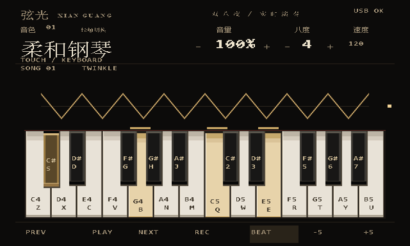

# 弦光 · FPGA 多音色数字乐器

以 **v2.1.2** 工程为基线的 Tang Nano 20K 多音色数字乐器。FPGA 完成 DDS 波形合成、24 声部、8种音色、音符包络、混音、效果处理和 I²S 扬声器输出，并通过 HDMI 显示双八度琴键、波形和控制状态。

本次整理保留 v2.1.2 的 RTL、引脚约束、音频/画面数据、FPGA 固件和输入交互 C 源码原始字节，附逐文件校验。当前版本输出 **640×480、60Hz** HDMI；设计预览按 800×480 面板展示。以本仓库代码和下图为准。



## 快速查看与构建

下载仓库后，打开根目录的 [界面预览.html](界面预览.html)，可以切换待机与演奏预览。GitHub 文件页展示HTML源码，预览请在本地打开。

Windows PowerShell，仓库根目录：

```powershell
# 检查原始核心文件和随附固件的完整性
./scripts/check_project.ps1

# 使用已安装的 Gowin Education 工具离线重建；不会烧录
./fpga_source/scripts/build_fpga.ps1 -GowinRoot 'C:\Gowin'

# 使用 OSS CAD Suite 的 Icarus Verilog 运行仿真
./fpga_source/scripts/test.ps1 -OssRoot 'C:\oss-cad-suite'
```

Gowin 工程：[control.gprj](fpga_source/control.gprj)。器件 `GW2AR-LV18QN88C8/I7`，顶层 `hdmi_instrument_top`，板载时钟27MHz。推荐与原包一致的 Gowin Education V1.9.11.03。预生成的 `.hex` 文件已随仓库提供，普通重建不需要重新生成字体。

离线构建输出位于 `fpga_source/build/firmware/`，随包的 `fpga_source/firmware/control.fs` 保留为原始基线固件。硬件烧录需要自行连接和确认目标设备。

## 目录

| 路径 | 内容 |
| --- | --- |
| `fpga_source/rtl/` | FPGA 音频、姿态、旋钮、串口、HDMI逻辑 |
| `fpga_source/constraints/` | 引脚和时钟约束 |
| `fpga_source/assets/` | 字库、显示数据和当前界面预览 |
| `fpga_source/firmware/` | v2.1.2原始固件及清单 |
| `fpga_source/sim/` | 仿真测试与可直接使用的参考向量 |
| `fpga_source/scripts/` | 构建、数据生成、ROM校验与仿真入口 |
| `触摸界面交互源码/` | 键盘报告、曲谱/录制状态与USB触摸适配代码 |
| `docs/` | 接线、协议、工程边界、匿名提交和验证说明 |

进一步阅读：[硬件接线](docs/HARDWARE.md)、[输入与串口协议](docs/CONTROLS.md)、[工程范围与依赖](docs/SCOPE.md)、[验证记录](docs/validation/README.md)。

## 工程边界

FPGA端源码、约束和显示/音频数据在本仓库中完整保留。提供的输入 C 文件是平台集成组件；原包缺少 `song_library.h`、完整 BL616/USB Host SDK 工程及其可烧录镜像，需要与对应平台工程一起集成。原包中部分电脑控制脚本依赖未提供的 `controller/` 或 `testdata/`，已归档至 `docs/legacy_scripts/` 并说明用途。

本次工作进行本地检查和离线验证，不代表重新进行了实板测试。详细结果见验证记录；既有固件清单中的硬件状态是原版本记录。
